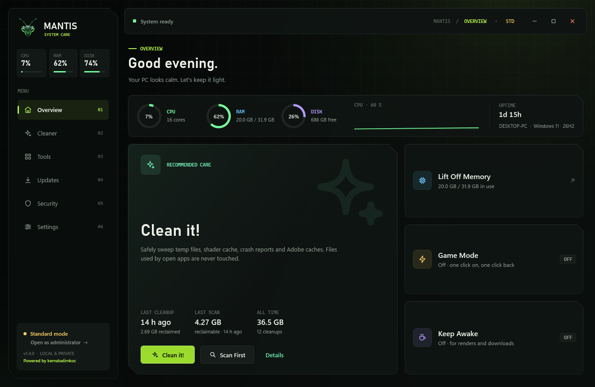
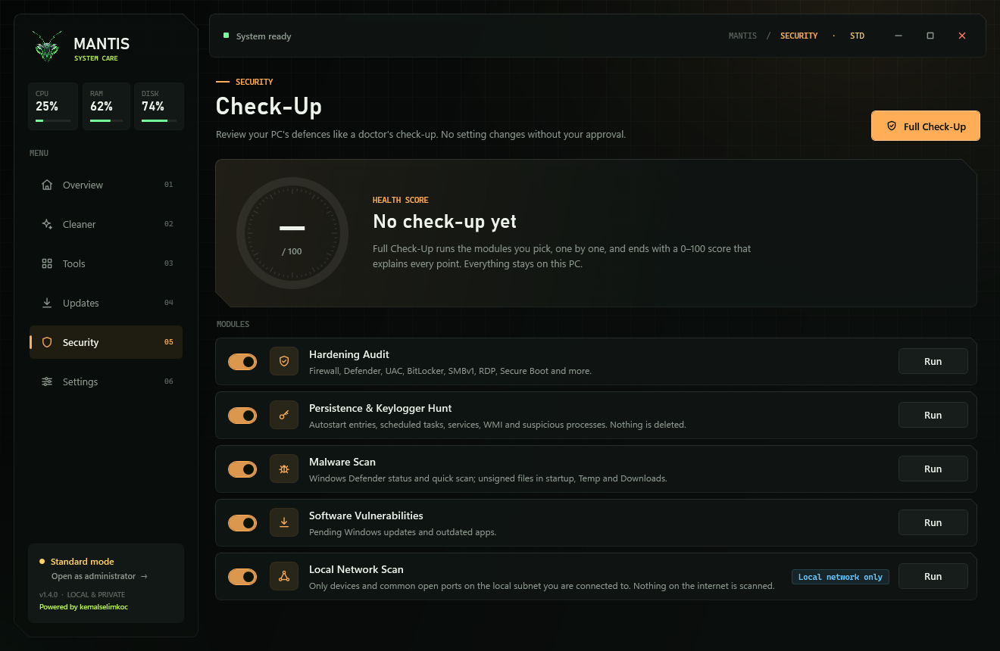
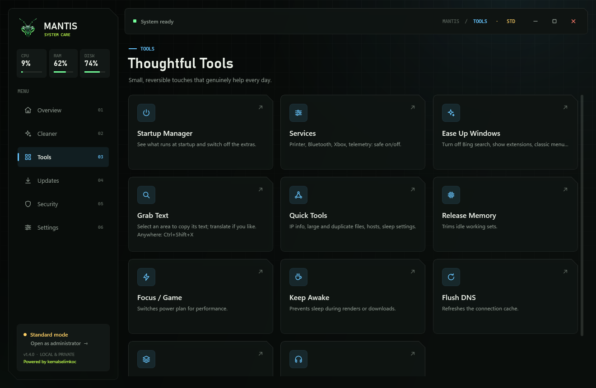
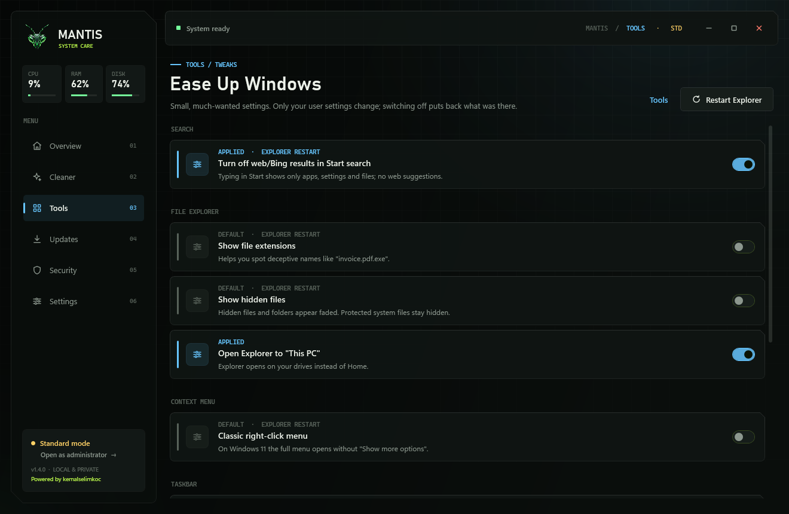
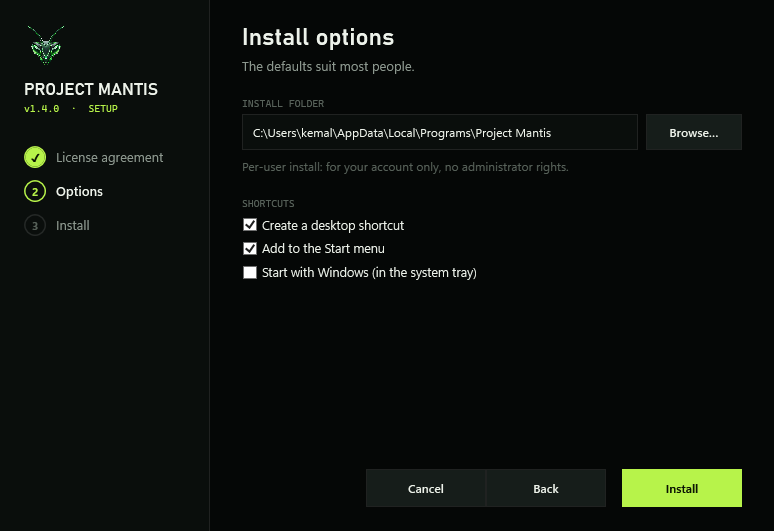

<div align="center">


# Project Mantis

**A local-first Windows care and security check-up tool. One small exe, no telemetry, every change asks first.**

[](https://github.com/kemalselimkoc/Project-Mantis/actions/workflows/build.yml)
[](https://github.com/kemalselimkoc/Project-Mantis/releases/latest)
[](https://github.com/kemalselimkoc/Project-Mantis/releases)
[](LICENSE)


[**Download**](https://github.com/kemalselimkoc/Project-Mantis/releases/latest) · [Changelog](CHANGELOG.md) · [Privacy](PRIVACY.md) · [Support development](https://buymeacoffee.com/kemalselimkoc)



</div>

## Why Mantis

- **Asks before it acts.** Every fix, toggle and update shows what it will do and waits for your confirmation; tweaks and toggles can be switched back.
- **Nothing runs in the background.** No services, no scheduled scans, no telemetry. Everything happens when you click.
- **Tiny and self-contained.** A single ~2.6 MB exe built on the .NET Framework 4.8 that ships with Windows. No runtime, no SDK, no installer bloat.
- **Defensive only.** It audits your own PC and your own local network. It never deletes or quarantines files; it explains findings and points you to Microsoft Defender.
- **Turkish and English** interface.

## Features

### Security Check-Up



A 0–100 health score built from five modules you can run together or one by one:

| Module | What it checks |
| --- | --- |
| **Hardening Audit** | Firewall, Defender, UAC, BitLocker, SMBv1, RDP, Secure Boot and more, with guided fixes you confirm one by one |
| **Persistence & Keylogger Hunt** | Autostart entries, scheduled tasks, services, WMI subscriptions and suspicious processes |
| **Malware Scan** | Defender status and quick scan, plus unsigned files in startup, Temp and Downloads |
| **Software Vulnerabilities** | Pending Windows updates and outdated apps |
| **Local Network Scan** | Devices and common open ports on the subnet you are connected to (asks first; your own network only) |

Each run ends with an HTML report stored locally.

### Updates

Finds outdated apps with `winget` and shows Windows Update status. Update one app or all of them, always after a confirmation.

### Cleaner

Allowlist-based cleanup of temp folders, DirectX shader cache, crash reports and Adobe media caches. Adobe caches are skipped while Adobe apps are running. Scan first, then clean.

### Tools



- **Startup Manager:** see what starts with Windows and switch the extras off, the same way Task Manager does.
- **Services:** a short allowlist of safe-to-disable services (printer, fax, Xbox, telemetry, Bluetooth…) with exact restore.
- **Ease Up Windows:** turn off Bing results in Start search, show file extensions, open Explorer on This PC, classic right-click menu, hide Widgets/Task View and more. Every tweak remembers the previous value.
- **Grab Text** (`Ctrl+Shift+X`): select any area of the screen and copy its text, recognised offline by Windows' built-in OCR. Translation opens Google Translate in your browser only if you click.
- **Quick Tools:** network info, large and duplicate file finder (sends to Recycle Bin), hosts file editor with backups, display/sleep timeouts.
- **Release Memory, Game Mode, Keep Awake, Flush DNS, Ghost Overlay, Audio Balance.**



## Install

1. Download **`ProjectMantis-Setup-v1.4.1.exe`** from the [latest release](https://github.com/kemalselimkoc/Project-Mantis/releases/latest).
2. Run it, accept the license agreement, pick the folder and shortcuts, press **Install**.
3. Setup is per-user (no administrator rights). Mantis appears in **Settings → Apps**, where it can be uninstalled.



Prefer not to install? Download `Project-Mantis-v1.4.1-portable.zip`, extract it and run `ProjectMantis.exe`.

The build is not code-signed yet, so Windows SmartScreen may show a warning. Compare the file's SHA-256 with the value on the release page (`Get-FileHash .\ProjectMantis-Setup-v1.4.1.exe`). Signing is planned; see [SIGNING.md](SIGNING.md) and the [code signing policy](CODE_SIGNING_POLICY.md).

> [!WARNING]
> **Possible false positive.** Microsoft Defender has flagged the unsigned v1.4.0 download as `Trojan:Win32/Sabsik.EN.A!ml`. The `!ml` suffix means a machine-learning guess about a new, unsigned file, not a matched malware signature. The file is built in public by GitHub Actions from this source code. We have reported it to Microsoft as a false positive; it clears once Defender's definitions update. If you prefer not to wait, build from source (below) or check back in a few days. Please do not turn off your antivirus for this.

Mantis starts in standard-user mode. Checks and fixes that need administrator rights show a **Restart as administrator** button.

## Build from source

Requires only Windows 10/11; no Visual Studio or .NET SDK.

```powershell
git clone https://github.com/kemalselimkoc/Project-Mantis.git
cd Project-Mantis
.\build.ps1          # builds dist\ProjectMantis-v<version>.exe with the Framework csc.exe
.\install.ps1        # optional: build, accept the license, create a desktop shortcut
```

Every push is built and self-tested by [GitHub Actions](.github/workflows/build.yml).

## Privacy

Mantis has no telemetry, analytics or account. Settings, the activity log and Check-Up reports stay under `%LOCALAPPDATA%\ProjectMantis`. The internet is used only for actions you start: winget updates, the optional public-IP lookup and opening Google Translate in your browser. Details in [PRIVACY.md](PRIVACY.md).

## Responsible use

- Run the network scan only on networks you own or are allowed to test.
- The Security Check-Up is advisory and is not an antivirus.
- Back up important data and create a System Restore point before changing system settings.
- Software updated through winget is licensed to you by its own publisher.

## Contributing

Bug reports, ideas and pull requests are welcome. Read [CONTRIBUTING.md](CONTRIBUTING.md) first; the short version is: C# 5, no NuGet packages, nothing that changes a setting without asking.

## License

Copyright © 2026 **kemalselimkoc**. Source code under the [MIT License](LICENSE). End-user terms in [EULA.txt](EULA.txt), attributions in [THIRD_PARTY_NOTICES.md](THIRD_PARTY_NOTICES.md).

The software is provided "as is", without warranty of any kind. Project Mantis is an independent project and is not affiliated with, endorsed by or sponsored by Microsoft. Windows, Microsoft Defender and related names are trademarks of the Microsoft group of companies.

---

<sub>🇹🇷 Mantis Türkçe arayüzle gelir. Hata bildirimi ve öneriler Türkçe de yazılabilir.</sub>
